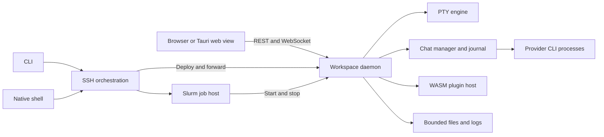

# Repository robustness and agent experience plan

Inventory date: 2026-10-15. Code baseline: `d8a99391`.

Status: Phases 0–2 and Phase 4 landed on 2026-10-15, each in one pull request (see the execution records at the end of §9). Phases 3 and 5–8 remain proposed.

Chimaera needs clearer ownership boundaries, stronger integration checks, and
smaller agent entry documents. Preserve its daemon ownership model and existing
feature behavior. Fix demonstrated defects before large structural changes.

This plan covers all 23 feature-catalog pages, the underlying platform, the test
system, and development across multiple worktrees. It records a breadth-first
inventory and targeted code reviews. It does not certify every code path or
dependency as safe. Findings state their evidence level.

## 1. Inventory

### Repository size

Counts include tracked tests and fixtures. They are not production-code counts.

| Item | Observed count |
|---|---:|
| Tracked files | 1,171 |
| Rust files and lines | 224 / 188,689 |
| Svelte files and lines | 199 / 88,964 |
| TypeScript files and lines | 376 / 80,237 |
| Markdown files and lines | 122 / 28,414 |
| Rust crates under `crates/` | 8 |
| Cargo workspaces | 3: daemon, native app, plugin fixtures |
| Feature pages, excluding their index | 23 |
| `AGENTS.md` maps | 14 |
| Canonical skills and Codex bridges | 10 pairs |
| Agent roles and Codex bridges | 2 pairs |
| Path-scoped rule files | 5 |
| GitHub workflow files | 7 |

Static scans found 1,608 Rust test attributes under `crates/`, including 37
ignored attributes. The UI has 142 TypeScript test files. These counts are not
executed-test totals or coverage measurements.

### Architecture that exists

The architecture has useful boundaries. Keep them unless evidence supports a change.

| Area | Current responsibility | Boundary to preserve |
|---|---|---|
| `chimaera` | CLI dispatch and process entry | Delegate domain work to library modules |
| `chimaera-core` | Paths, identity, lifecycle records, shell integration, cluster types | No internal crate dependencies or transport implementation |
| `chimaera-pty` | PTY processes, terminal state, snapshots, shell execution | Terminal state remains on the daemon |
| `chimaera-agent` | Provider adapters, normalized events, command admission, journals | Native provider protocols stay behind adapters |
| `chimaera-server` | Authenticated APIs, sockets, feature services, persistence, plugin host | Own workspace operations and enforce resource limits |
| `chimaera-remote` | SSH, deployment, tunnels, cluster orchestration | Share transport behavior between CLI and native shell |
| `chimaera-plugin-api` | WIT and guest-facing types | Preserve supported plugin API versions |
| `chimaera-app` | Tauri windows, native capabilities, updates, WSL | Remain a separate Cargo workspace |
| `web-ui` | Svelte views, reactive stores, client transport, previews | Views do not own daemon processes |
| `plugins` | Curated release lock and test guests | Production plugins remain in their own repositories |



This is a runtime responsibility diagram. Cargo dependency edges are separate.
The daemon, native shell, and plugin guests also have separate build lifecycles.

### Existing strengths

- The repository states its key invariants explicitly.
- PTY tests cover real processes and terminal snapshot replay.
- Chat and PTY golden tests protect serialized wire shapes.
- Server tests exercise routes, persistence, permissions, plugins, and lifecycle behavior.
- Plugin fixtures cover supported API versions and hostile guest behavior.
- UI tests cover reducers, layout, parsing, transport policies, and shared helpers.
- The UI enforces a 500,000-byte entry-chunk budget in its Vite build.
- Real WebKit and Chromium performance harnesses already exist.
- Live provider tests address protocol drift that fixtures cannot detect.
- CI uses pinned Actions, explicit permissions, dependency review, and lockfiles.
- The feature catalog separates derived behavior from maintainer intent.
- Development has isolated daemon and native-app launchers.

Extend these mechanisms. Avoid replacing working infrastructure merely for consistency.

### Concentrated complexity

| File or area | Observed size | Review purpose |
|---|---:|---|
| `web-ui/src/App.svelte` | 8,832 lines; 104 imports; 55 effects | Separate window lifecycle, workspace state, rail actions, and composition |
| `web-ui/src/lib/chat/ChatView.svelte` | 4,120 lines; 87 imports; 21 effects | Separate transcript viewport, commands, and attached UI surfaces |
| `crates/chimaera-agent/src/codex.rs` | 12,545 lines | Separate protocol responsibilities; many lines are tests |
| `crates/chimaera-agent/src/claude.rs` | 10,765 lines | Separate protocol responsibilities; many lines are tests |
| `crates/chimaera-server/src/chat.rs` | 5,619 lines | Clarify spawn, switch, fork, rewind, recovery, and exit ownership |
| `crates/chimaera-remote/src/lib.rs` | 5,352 lines | Separate SSH configuration, deployment, connection state, and forwarding |
| `crates/chimaera-server/src/fs.rs` | 4,898 lines | Separate path policy, file operations, format readers, and ticketed serving |
| `crates/chimaera-server/src/state.rs` | 77 `AppState` fields | Identify invariant owners across registries and services |
| `web-ui/src/lib/previews/` | 114 source/test files; 44,807 lines | Define common preview lifecycle and format-specific extension points |
| `web-ui/src/lib/workspace/` | 78 source/test files; 26,792 lines | Clarify domain ownership and common workbench interactions |

File size is a review signal. It is not a defect by itself. Moving tests to another
file reduces file length without reducing production complexity. Split code by
state ownership and independent change reasons.

### Agent context costs

| Document | Words | Consequence |
|---|---:|---|
| Root `AGENTS.md` | 1,633 | Usable index; still has repeated commands and policy |
| Server `AGENTS.md` | 12,078 | An area entry point is also a detailed implementation manual |
| Chat UI `AGENTS.md` | 9,511 | A small UI change can require a large context load |
| Plugin UI `AGENTS.md` | 4,053 | Needs a shorter task-routing map |
| Architecture guide | 13,494 | Mixes platform structure and detailed feature behavior |
| Agent `PROTOCOL.md` | 38,129 | Current protocol rules and dated investigations need separate entry paths |
| Chat feature page | 17,215 | Needs subfeature references behind a short feature contract |
| Files and previews feature page | 16,777 | Needs format-family references and a concise common contract |

At the baseline there was no area map for `chimaera-remote`, and the UI lacked maps for `net`, `layout`, `previews`, `terminal`, `browser`, `workspace`, and `shared`; agents had to discover the routing from module headers. Wave 1 added all eight (see the execution record in §9).

## 2. Findings from targeted review

Priority expresses repair order. Evidence labels distinguish reproduced logic,
confirmed code paths, and security questions that need a live test.

### B1. Environment saves overwrite unchanged values from stale windows

Priority: P2. Evidence: reproduced with the current `save` function in isolation.

Source: [EnvironmentSettings.svelte](../../web-ui/src/lib/settings/EnvironmentSettings.svelte),
lines 61–80 at the baseline.

The save function fetches fresh environment data. It then writes both editor
values, including a scope that the user did not change.

Reproduction:

1. Open Environment in two windows.
2. Change and save the host prelude in the second window.
3. Change only the workspace prelude in the first window.
4. Save from the first window.

The first window restores its old host prelude. The reverse case can restore an
old workspace prelude. This does not require simultaneous requests.

Repair: submit only dirty scopes. For concurrent writers, add an explicit revision
check or a server-side scoped update. A fresh GET followed by whole-map PUT is
still vulnerable to a change between those requests.

Regression checks: unchanged-scope preservation, two-window updates, explicit
deletion, same-scope conflict, and edits made while a save is pending.

### B2. Failed settings writes do not retry when a settings frame arrives

Priority: P2. Evidence: reproduced with the current store functions in isolation.

Source: [store.svelte.ts](../../web-ui/src/lib/settings/store.svelte.ts),
lines 148–184 at the baseline. App call sites were checked as well.

`flushSettings` leaves the dirty flag set after a failed PUT. Its comment says a
reconnect echo retries the write. `applyRemoteSettings` instead returns immediately
while that flag is set. No retry is scheduled by this path.

Reproduction: fail a settings PUT, restore the connection, and deliver a settings
frame. The local edit remains unsaved and incoming settings remain ignored.
Another edit or page-hide flush can retry; reconnect alone does not.

Repair: give settings persistence an explicit single-writer state machine. Retry
after connection recovery with bounded backoff. Show an unsaved or failed state.
Preserve pending edits and prevent an old response from replacing a newer edit.

Regression checks: offline edit then reconnect, failed response then retry,
out-of-order responses, two-window edits, and page hide during an outstanding PUT.

### B3. Settings and environment routes perform blocking filesystem work

Priority: P2. Evidence: confirmed call paths; no slow-NFS runtime test in this pass.

Sources: [settings.rs](../../crates/chimaera-server/src/settings.rs), lines 341–399;
[environment.rs](../../crates/chimaera-server/src/environment.rs), lines 353–399;
[persist.rs](../../crates/chimaera-server/src/persist.rs).

Async handlers call stores that use synchronous metadata, read, write, and rename
operations. They also hold standard mutexes during those operations. Slow storage
can block runtime workers and callers waiting for those locks. The daemon uses
four async workers, so the shared-host impact matters.

Repair: move disk work to bounded blocking jobs. Keep related operations ordered.
Audit the other callers of `current()` and persistence helpers for the same pattern.
Keep lock ownership and notification ordering explicit.

Regression checks: inject delayed storage and verify that unrelated health and
WebSocket work continues. Bound concurrent blocking jobs. A blocking task that has
started cannot generally be aborted, so a timeout alone is insufficient.
See [Tokio blocking-task guidance](https://docs.rs/tokio/latest/tokio/task/fn.spawn_blocking.html).

### B4. State-file size checks occur after full allocation

Priority: P2. Evidence: confirmed code paths.

Sources: [settings.rs](../../crates/chimaera-server/src/settings.rs), lines 57–60;
[environment.rs](../../crates/chimaera-server/src/environment.rs), lines 162–165.

Both stores call `std::fs::read` before checking their 256 KiB limits. An oversized
file is fully allocated before rejection. The HTTP body cap does not protect
external file edits or damaged state files.

Repair: use a shared bounded reader that reads at most the limit plus one byte.
Do not rely only on a metadata check because a file can grow after that check.
Review journal indexes, recents, workspace state, and draft loaders for the same
pattern. Confirm each caller before changing it.

Regression checks: oversized files, files that grow during reading, malformed
JSON, missing files, and preservation of the last valid settings where appropriate.
This is a resource-safety defect. Remote exploitation was not established.

### S1. Browser panes share workbench authority

Priority: deferred threat-model review. Evidence: confirmed and already documented.

Sources: [browser-pane constraints](../features/browser-pane.md#key-constraints),
[BrowserView.svelte](../../web-ui/src/lib/browser/BrowserView.svelte),
[proxy.rs](../../crates/chimaera-server/src/proxy.rs), and
[MCP tool policy](../../crates/chimaera-server/src/mcp.rs).

Proxied pages share the workbench origin. Their scripts can reach the parent page
and its session storage. The same-user case often adds little host authority.
A service owned by another user on a shared host has a different trust boundary.
Native parent access also requires separate review of local IPC capabilities.

Maintainer steering in this audit: this risk is lower priority than initially
suggested. Keep it visible as an existing trust tradeoff. Do not make an
origin-isolation redesign a prerequisite for the robustness work.

Future check: use a harmless local fixture to test actual parent, token, and IPC
access. Review only the capabilities the fixture can reach. Record deployment
assumptions. Revisit isolation if supported use expands to untrusted web apps.

### S2. Proxy response policy can allow capability URLs into referrers

Priority: P2 investigation. Evidence: conditional code finding; browser reproduction pending.

Source: [proxy.rs](../../crates/chimaera-server/src/proxy.rs), lines 1379–1385.

The proxy adds `Referrer-Policy: same-origin` only when the upstream response has
no policy. An upstream `unsafe-url` policy remains unchanged. A subsequent
cross-origin request can therefore include the proxy capability path in its
referrer. Exploitation also requires a recipient that can reach that daemon.

Check with a local upstream fixture and a local referrer collector. Send no real
token or user content. If confirmed, define a proxy-owned policy floor and test
navigation and subresource requests. Review document-level overrides as well;
a response-header change alone is not a complete containment boundary for scripts.

### D1. Documentation checks do not establish semantic accuracy

Priority: P2 for the agent-experience workstream. Evidence: checked scripts and examples.

The link, site, bridge, and workflow-security checks pass. However:

- The doc-drift hook checks working-tree paths and whether a document also changed.
- It does not check whether the document correctly describes the change.
- The Codex hook file contains worktree hooks, but no matching doc-drift hook.
- Bridge parity checks references and names. It does not check rule or hook parity.
- The chat wire-test header says the client has no automated tests. UI reducer
  tests now exist. The intended distinction is the lack of component/browser tests.
- The daemon rule's authentication summary omits some ticketed data-plane routes.
  The router implements explicit download and proxy capability paths.

Repair: use shared feature ownership data and contract tests for verifiable facts.
Keep a review step for behavior, rationale, and intent. Permit an explicit
documentation-not-affected result for internal changes.

### Test-environment limitation

The worktree-GC suite reported 117 passes and 32 failures. This sandbox denies
`ps`. Preview classification calls `ps` and conservatively treats those processes
as active. This explains the preview-removal failures in this run.

Do not weaken the cleanup safety policy to make these tests pass. Separate
deterministic process-snapshot tests from real process integration tests. Report a
missing process-inspection capability before the integration suite starts.

## 3. Scope every feature as a complete change unit

Each feature needs a short contract. The contract must cover these fields:

1. User operation and supported entry points.
2. Owning modules and the one state owner for each invariant.
3. Inputs, outputs, events, and external processes.
4. Persistent state, its schema, and recovery behavior.
5. Authority, validation, and resource limits.
6. Loading, empty, failure, retry, cancellation, and disconnected states.
7. Dependencies and effects on other features.
8. Extension procedure and the minimum required checks.
9. Known limits and maintainer intent, with dates.

The following table scopes all current catalog features. Proposed checks extend
existing tests; a named area does not imply that its current coverage is absent.

| Feature | Implementation boundary and review | Interactions and required evidence |
|---|---|---|
| [Workbench](../features/workbench.md) | `App.svelte`, `layout/`, workspace stores, daemon view-state. Separate window coordination from rendering. Define pane creation, visibility, disposal, tab identity, and cross-window transfer. | Chat/terminal pools, previews, native windows, drafts. Verify split/move/detach/reattach, focus, restored layouts, missing sessions, and two windows editing views. |
| [Dashboard](../features/dashboard.md) | `dashboard/`, session state, history, notices, comms. Document which source controls each badge and count. Keep aggregation separate from card rendering. | Permission answers, wake requests, Mastermind, Knowledge, Git. Test duplicate/stale events, no provider, no sessions, invisible panels, and simultaneous answers. |
| [Agents](../features/agents.md) | Launcher, detection, managed runtimes, setup/auth operations, session rail. Keep process resolution, installation, authentication, and readiness separate. | Environment, SSH/WSL, settings, runtime leases. Test failed login shells, custom paths, concurrent install/launch, cancellation, sign-in expiry, and provider-specific readiness. |
| [Chat mode](../features/chat-mode.md) | Agent manager/adapters, journal, server chat, chat transport/reducer/view. Define send admission, queue ownership, turn lifecycle, and command results. | Approvals, questions, subagents, forks, rewind, terminal switch, voice, uploads, artifacts. Test every supported provider capability and unsupported-control behavior. |
| [Claude Mods](../features/claude-mods.md) | `native_ui.rs`, transient WS frames, Mod controllers, iframe/worker runtime. Preserve the boundary between transient UI and durable events. | Composer revisions, focus, settings, chat visibility. Test stale callbacks, malformed trees, worker limits, disconnect, replay exclusion, and client termination. |
| [Terminals](../features/terminals.md) | PTY session, snapshots, marks, exec, xterm pool and transport. Define byte ordering and size authority. | Layout, linked terminals, reconnect, agent TUIs, clipboard. Test exact snapshot replay, Unicode, alternate screen, lag, resize storms, parked output, and process exit. |
| [Linked terminals](../features/linked-terminals.md) | `links`, MCP tools, shared exec engine, terminal controls. Keep grants and command admission in the daemon. | Session ownership, agent tools, shell state, cancellation. Test grant/revoke during execution, wrong agent, busy shell, timeout, disconnect, and terminal exit. |
| [Agent communication](../features/agent-communication.md) | `comms`, MCP, hook carriers, chat signals, wake policy. Define delivery claims, acknowledgement, and bounded wake transitions. | Timeline, Mastermind, notices, subagents, provider queues. Test simultaneous readers, retries, duplicate carriers, busy/idle transitions, wake caps, and shutdown during delivery. |
| [Session history](../features/session-history.md) | History service, recents/archive, episode capture, session changes. Separate durable records from live projections. | Git, Timeline, dashboard, resumables, uploads. Test replay without duplicate accounting, unavailable native transcripts, deleted repositories, archived records, and same-file notices. |
| [Timeline and Knowledge](../features/timeline-and-knowledge.md) | Timeline writer, episodes, provider interface, Knowledge UI. Define sequence ownership and provenance. | Plugins, comms, guidance files, dashboard. Test compaction, corrupt tails, provider removal, duplicate IDs, missing sources, large trees, and read-only boundaries. |
| [Files and previews](../features/files-and-previews.md) | Filesystem service, tickets, editors, draft mirror, preview loaders. Define a shared view lifecycle and format-specific limits. | File watches, references, chat artifacts, plugins, native close. Test save conflicts, external rename/delete, draft recovery, lazy loading, selection, and hostile format inputs. Split the format scope below. |
| [Browser pane](../features/browser-pane.md) | Proxy control/data planes, target policy, browser view, `open_browser`. Document the existing trust model. | SSH forwards, Slurm second hop, cookies, redirects, native links. Test HTTP/WS, expired capabilities, multiple apps, wrong target, ended allocation, and referrer policy. |
| [Drag and uploads](../features/drag-drop-and-uploads.md) | Native/browser drops, path references, session/folder uploads. Separate move, copy, reference, and byte upload. | Host identity, session lifetime, file manager, composer. Test simultaneous same-name files, quotas during concurrent streams, abort cleanup, Unicode names, and remote ownership. |
| [Git](../features/git.md) | Resolve/parse/service/routes/worktree modules and Git UI. Separate read-only inspection from worktree mutations. | Session branches, multi-repo workspaces, history, worktree launch. Test dirty/untracked/locked trees, binary files, large diffs, hostile names, missing Git, and concurrent requests. |
| [Remote connect](../features/remote-connect.md) | Remote library, host store, deployment, tunnel and shell connection state. Add the missing area map. | Native authentication, local daemon parity, cluster routes, reconnect. Test SSH cancellation, dead ControlMaster, changed host keys, partial deployment, port changes, and multiple windows. |
| [Compute](../features/compute.md) | Core Slurm parsers/types, remote cluster orchestration, job-host, workspace leases, cluster UI. Define allocation and workspace ownership transitions. | Persistence, SSH, environment, agent instructions, notifications. Test pending/running/ended jobs, walltime, node changes, held workspace, continuation, and shared-home races. |
| [Native app](../features/native-app.md) | Tauri shell, command manifest/grants, windows, updates, askpass, WSL. Preserve command and origin scope. | Daemon adoption, remote UI, clipboard, printing, voice, unsaved edits. Test close/quit, restore, signed plugins, update failure, WSL user identity, and denied native commands. |
| [Lifecycle and persistence](../features/lifecycle-and-persistence.md) | Lifecycle, ledger, chat resurrection, stores, handoff, cleanup. Define shutdown order and crash guarantees. | Every live session, window, job, draft, and upload. Test graceful stop versus crash, partial records, token rotation, old records, slow disk, and concurrent restore/open/delete. |
| [Environment](../features/environment.md) | Prelude store, composition, materialization, probe environment, settings UI. Fix B1/B3/B4. | Launcher, login shell, cluster startup, workspace deletion. Test scope precedence, exactly-once application, concurrent edits, failed commands, and cleanup. |
| [Settings](../features/settings.md) | Schema, UI store, server store, external edit watcher, appearance bootstrap. Fix B2/B3/B4. | All settings consumers, native appearance, multiple windows. Test defaults, unknown keys, invalid values, offline writes, old responses, external edits, and cross-window conflicts. |
| [Notifications](../features/notifications.md) | Notice edge watcher, feed, unread state, native/browser delivery. Document deduplication and ownership of seen state. | Agent status, dashboard, wake requests, Slurm, window focus. Test several windows, suppressed foreground notices, click routing, permission refusal, and stale session links. |
| [Plugins](../features/plugins.md) | WIT, manifests, host imports, trust, installs, jobs/tools, UI schema, agent connections/skills. Keep sandboxed and privileged capabilities explicit. | Knowledge, previews, settings, MCP, file events, updates. Test old API guests, capability changes, revoke/rollback, traps, timeouts, hostile archives, and removal during active work. |
| [CLI](../features/cli.md) | Clap parsing, dispatch, machine output, doctor, daemon management. Keep CLI behavior discoverable and testable. | Server, remote library, plugins, compute, shell integration. Test help/errors/exit codes, stdout versus stderr, manifest node ownership, and commands without an active daemon. |

### File and preview subfeatures

This area is too broad for one implementation ticket. Use independent fixture
sets and explicit capabilities for each family.

| Family | Separate checks |
|---|---|
| Text and source | Encoding, long lines, syntax loading, search, selections, large files |
| Markdown and live editing | Source/render agreement, links, embeds, math, sanitizer, conflict recovery, print |
| CSV, TSV, gzip, spreadsheets, Parquet | Row/column limits, incremental reads, decompression expansion, schema errors, sort/filter correctness |
| PDF and images | Ranged reads, worker/canvas disposal, scaling, selection, page limits, decode errors |
| Word, PowerPoint, notebooks | Unsupported content, bounded expansion, MIME selection, embedded scripts, partial rendering |
| HTML and browser apps | Separate sandboxed file reports from live proxy trust; test both |
| Audio and video | Range handling, seek, cancellation, remote latency, decoder cleanup |
| Diagrams and boards | Serialization, round-trip edits, IDs, undo, references, large canvases |
| Shared document tools | Find, copy, selection references, embeds, unsaved state, print/export, native close |

Do not force every renderer through one large generic component. Share lifecycle,
loading, errors, limits, references, and toolbar primitives where their contracts match.

## 4. Review the platform between features

| Platform contract | Required review | Proof of completion |
|---|---|---|
| Session identity and lifecycle | Enumerate registries, transitions, reservations, cleanup, and lock order | Transition tests cover duplicate requests and failures at each boundary |
| Daemon-to-UI wire | Inventory REST, three main WS feeds, voice, transient Mods, and errors | Rust-produced fixtures are consumed by real TypeScript decoders/reducers |
| Provider wire | Separate native frames from normalized events and capabilities | Sanitized fixtures plus the applicable live smoke gate |
| Durable storage | Record path, writer, cap, permissions, schema, retention, recovery, and atomicity | Crash/partial-write/oversize/old-schema tests per store class |
| Process lifecycle | Record child-group ownership, stdin/out bounds, cancellation, and reaping | No orphan groups after cancellation, timeout, or failed startup |
| Async work | Find blocking calls, long lock holds, spawned tasks, and queue owners | Bounded concurrency and continued unrelated request progress under slow I/O |
| Host identity | Distinguish local, SSH, job host, workspace daemon, and WSL paths | Wrong-host/path/PID tests fail safely |
| Capability boundaries | Inventory bearer, per-session key, raw/download/proxy ticket, plugin grant, and native IPC | Unauthorized and wrong-scope requests fail at the boundary |
| Client lifetime | Distinguish window, workspace, pane, pooled session, and transient view | Hiding/eviction/disposal tests preserve live work and release client resources |
| Resource budgets | Specify workload, owners, limits, overflow policy, and measurement | Stable memory/process/descriptor counts under repeated work and idle periods |
| Error behavior | Standardize typed internal errors and preserve current public responses | Timeout, cancelled, stale, unauthorized, unsupported, and unavailable remain distinct |
| Dependency and build boundaries | Review runtime dependencies, feature flags, lockfiles, generated assets, and platform gates | Clean builds and architecture checks protect intended dependency directions |

### Wire-contract improvement

The Rust golden tests are valuable. The chat client currently accepts an event
with `type: string` and unknown fields in `chatWs.ts`. This weakens compile-time
checks across the language boundary.

Start with shared serialized fixtures and consumer tests. Then evaluate generated
TypeScript unions or schemas from the actual Rust wire types. Verify serde tags,
flattening, omitted fields, null values, integers, and unknown variants before
adopting a generator. Preserve tolerance for additive fields and older journals.

Do not add a manually maintained parallel type hierarchy. Do not change wire
formats as a side effect of moving modules.

### Refactor sequence

1. Add characterization checks around the boundary to move.
2. Separate pure decisions from process, disk, and network effects.
3. Move one responsibility behind a small existing or new module interface.
4. Preserve serialized shapes and visible behavior.
5. Verify the complete affected flow.
6. Remove the superseded path after the replacement is proven.

For `App.svelte`, start with connection/recovery coordination and window layout
persistence. Follow with rail/session actions and cross-window transfer. Keep the
root as the composition owner. Preserve Svelte effect ordering and pane lifetime.

For server chat, separate spawn/recovery, view switching, fork/rewind, and event
projection. Introduce domain methods around related state before hiding 77 fields
inside cosmetic substructures. Avoid a single global session lock.

For provider adapters, separate decoding, request correlation, turn state,
approvals/questions, and background tasks. Preserve provider differences. Common
traits should express real shared behavior.

For filesystem and remote code, split policy from I/O and orchestration. Keep
validation at ingress and enforce invariants inside the service as well.

## 5. UI and UX contracts

Create a short internal UI guide and small examples for shared primitives.
Use the existing `shared/` helpers before introducing a separate design system.

Document these contracts:

- Theme tokens, spacing, type roles, density, and responsive behavior.
- Buttons, dialogs, popovers, menus, tabs, selection, and destructive actions.
- Focus entry, containment, restoration, Escape, and keyboard navigation.
- Loading, empty, partial, stale, error, retry, and cancelled states.
- Unsaved edits and recovery after a connection or window failure.
- Visibility and disposal rules for pooled views and background work.
- Accessibility names, live announcements, contrast, reduced motion, and zoom.
- The distinction between shared product terms and provider-native vocabulary.

The repository has useful helpers such as `ConfirmDialog`, `modalFocus`,
`toolbarPopover`, `FindBar`, and `Segmented`. Audit their use before replacing them.
Review the 67 Svelte accessibility-suppression occurrences individually. A
suppression count is not an accessibility defect count.

Add component/browser checks for behavior that pure helpers cannot prove.
Start with modal focus, permission answers, disconnected composer behavior,
unsaved close, pane switching, and error boundaries. Keep real WKWebView tests
for scrolling and native behavior. A browser engine test does not replace every
native integration check. See the [Svelte testing guide](https://svelte.dev/docs/svelte/testing).

## 6. Agent documentation and ASD-STE100

### Information structure

Use progressive disclosure with one canonical home for each fact.

| Layer | Content | Proposed size target |
|---|---|---|
| Root map | Product model, architecture edges, task routing, essential commands and invariants | About 1,200 tokens |
| Area map | Scope, entry points, state owners, critical invariants, test commands, links | About 800–1,500 tokens |
| Feature contract | User behavior, dependencies, extension procedure, acceptance checks | Short summary with detailed subfeature links |
| Procedure | Prerequisites, commands, expected results, failure recovery, cleanup | Load only for the current task |
| Reference | Wire fields, format details, state machines, budgets | Indexed by topic |
| History | Dated observations and superseded design reasoning | Never required for routine orientation |

These are proposed budgets. Measure tokens with the selected tokenizer. Do not
remove a safety invariant merely to meet a size target. A typical task should
find its owner, rules, and checks in roughly 2,500–4,000 guidance tokens before
reading implementation code.

Split the server and chat UI maps first. Split the protocol document into a short
current contract index, provider/topic references, and dated investigation notes.
Preserve stable links with redirects or updated anchors where practical.

### Writing rules

Use ASD-STE100 as the basis for internal technical prose. It combines writing
rules with controlled vocabulary. Short sentences alone do not establish
conformance. See the [official ASD-STE100 FAQ](https://www.asd-ste100.org/STE_faq.html).

Create a repository terminology list for software-specific technical nouns and
verbs. Keep API identifiers, command strings, filenames, and provider labels exact.
Apply the standard to maps, procedures, architecture references, and explanatory
comments. Public product messaging keeps its established voice.

The internal writing profile should require:

- One instruction per step and one main idea per sentence.
- Active voice and a named actor when ownership matters.
- Conditions before the action they control.
- Explicit inputs, limits, outcomes, and failure behavior.
- Stable terms for workspace, session, window, pane, host, job, and provider.
- Separate requirements, observed behavior, proposals, and historical intent.
- Links instead of repeated procedures and implementation narratives.

Example:

> Run the UI build before the Rust build. The server embeds the UI assets.
> If the UI build fails, stop. Do not use an older bundle to verify a UI change.

Start with vocabulary and sentence-length checks as warnings. Review their false
positives before adding blocking rules. Human review must still check meaning.
Do not label the corpus fully STE-compliant without vocabulary and rule validation.

### Prevent drift

Add a small feature registry that points to owners, paths, contracts, docs, and
checks. Avoid duplicating prose in it. Generate routing tables from this registry
where useful.

CI should check missing paths, missing owners, broken links, bridge parity, and
generated contract drift. A change-impact report should list affected feature
contracts. The author must update them or state why their behavior did not change.
Do not require meaningless edits to every matching document.

Use clean-context agent exercises to validate the documentation. Give an agent a
task such as adding a setting or a preview type. Record the files it reads, the
commands it chooses, missed invariants, and guidance tokens consumed. The task
passes when the agent finds the correct boundary and verification path without
loading the whole architecture manual.

## 7. Tests and final validation

### Existing test system

| Layer | Existing evidence | Improvement |
|---|---|---|
| Rust units | Parsers, models, stores, remote helpers, native logic | Add failure and transition cases where review finds gaps |
| Server integration | 49 Rust files under `src/tests`, including support/module files | Associate scenarios with feature contracts and add cross-feature cases |
| PTY integration | Real PTYs and snapshot replay | Add generated action sequences and disconnect/resize stress |
| Wire fixtures | Chat and PTY serialized-shape tests | Consume server-produced fixtures in the UI |
| UI units | 142 TypeScript test files in Node | Add browser/component behavior coverage for critical interactions |
| Live agents | Ignored Claude/Codex, ACP, and Mod tests | Record provider versions and sanitized observations |
| Native | App tests, platform builds, signed macOS plugin smoke, WSL smoke | Add user-flow verification for IPC and window lifetime |
| Runtime smoke | `scripts/smoke-daemon.mjs` exercises a real daemon and PTY | Extend into a small reliable scenario suite |
| Performance | WebKit tab switching and real-wheel transcript harnesses | Standardize fixtures, baseline reports, and regression thresholds |
| Repository scripts | Release, guards, worktree cleanup, links, bridges, workflows | Separate deterministic tests from host-dependent integrations |

No project-level property-testing, fuzzing, or coverage-report setup was found in
the inspected manifests and workflows. Add each only where it protects a real
boundary. Useful targets include path/URL parsers, shell quoting, NDJSON,
archive extraction, layout transitions, journal recovery, and command admission.

### Whole-platform scenarios

Each scenario must assert its outcome, cleanup, and resource behavior.

| Scenario | Required assertions |
|---|---|
| Workspace to result | Open workspace, start agent, answer permission, inspect generated file, open Git changes, find session history |
| Disconnect during work | Agent and PTY continue; reconnect restores ordered chat and terminal state; no duplicate user action |
| Restart and recovery | Restore supported conversations, layout, drafts, references, and current host identity; do not claim old processes survived |
| Two windows | Settings changes, permissions, notices, file saves, tab transfer, and close actions converge correctly |
| Chat to terminal and back | Preserve session identity and supported native history; settle queues and transient UI correctly |
| Fork and rewind | Verify native versus portable boundaries; do not re-execute copied history or revive stale approvals |
| Agent coordination | Deliver messages once within the intended semantics; respect wake limits, terminal grants, and user intervention |
| File editing under contention | External edits and agent writes cause explicit conflicts; drafts survive disconnect and native close |
| Plugin lifecycle | Install, trust, enable, use, update, revoke, rollback, and remove while work is active |
| SSH recovery | Cancel authentication, reconnect after tunnel loss, handle changed ports, and preserve remote sessions |
| Slurm lifecycle | Start allocation, open workspaces, reach a browser app, end allocation, continue elsewhere, and avoid lease overlap |
| Native lifecycle | Restore windows, close with dirty files, handle notifications, update failure, and WSL startup |
| Resource stress | Large transcripts/previews, many sessions, slow consumers, hidden windows, stalled storage, and cancellation |
| Unauthorized access | Wrong/missing/expired authority fails for REST, WS, tickets, plugin imports, and native commands |

Use pairwise combinations for ordinary feature coverage. Fully exercise the
critical session, data-loss, authority, and host-transfer combinations. A complete
Cartesian product of features, providers, platforms, and failure states is impractical.

### Verification gates

Fast checks run for each change. More expensive checks follow the affected contracts.

```sh
node scripts/check-doc-links.mjs
node scripts/check-site.mjs
node scripts/check-agent-assets.mjs
node scripts/check-workflow-security.mjs
bash scripts/version-bump.test.sh
bash .claude/hooks/guard-bash.test.sh
bash scripts/worktree-gc.test.sh
node --test .github/scripts/*.test.mjs

npm --prefix web-ui ci
npm --prefix web-ui run check
npm --prefix web-ui run test
npm --prefix web-ui run build
just check
just app-check
```

Run `just app-check` when native code or its shared dependencies change. Run the
platform bundle jobs where required. The root workspace does not cover the
standalone app workspace. A local build does not prove Windows or signed-bundle behavior.

Runtime changes require an isolated live flow. Use the existing `develop` and
`verify-app` procedures. Provider changes require `just chat-smoke` or
`just chat-smoke-acp`, as applicable. Claude Mod changes also need their focused
smoke. Live provider runs use authentication, network access, and billed turns.

Before a release containing the refactors, test the integrated commit with:

- The full applicable automated gates.
- Chromium and real macOS WebKit user flows; platform-specific native checks.
- Supported provider capability checks at recorded CLI versions.
- Local, SSH, and an actual Slurm allocation where compute behavior changed.
- Previous persisted-state and plugin-version fixtures.
- Repeatable idle and stress measurements on a named machine and workload.

Keep the existing ~150 MB daemon RSS target, but define the baseline workload and
child-process accounting before turning it into a pass/fail threshold. Measure
idle CPU, descriptors, tasks, children, memory growth, reconnect latency, and UI
responsiveness. Do not use an unexplained single memory number for every workload.

### Evidence from this inventory pass

Passed:

- Documentation links: 110 Markdown files checked by the current script.
- Public-site validation.
- Skill/agent bridge validation: 10 skills and 2 agents.
- Workflow security validation.
- Rust formatting in daemon, plugin, and native-app workspaces.
- Release-version script: 36 cases.
- Bash guard: 49 cases.
- GitHub script tests: 17 cases.
- Two isolated reproductions using extracted current settings functions.

Limited:

- Worktree-GC tests: 117 passed, 32 failed with `ps` denied by this sandbox.
- This checkout has no `node_modules`, UI bundle, Rust target, or plugin test assets.
- Full compilation, UI tests, live app flows, billed provider tests, and dependency
  vulnerability scans were not run in this planning pass.
- The isolated JavaScript reproductions prove the functions' behavior. They do
  not replace a mounted-component or full-app regression test.

## 8. Execution plan

Keep each change independently reviewable. Fixes, mechanical moves, contract
changes, and behavior changes should be separate commits or PRs where possible.

| Phase | Work | Dependency | Exit condition |
|---|---|---|---|
| 0 | Record feature/platform ownership, baseline commands, and known defects | This inventory | Every feature and shared contract has an owner and evidence status |
| 1 | Fix B1–B4; validate S2; add focused regressions | Phase 0 | Reproductions pass after repair; relevant live settings flows pass |
| 2 | Shorten agent maps, add missing maps, split current references from history | Phase 0 | Clean-context agents find owners, commands, and invariants within the guidance budget |
| 3 | Add wire consumer fixtures and critical browser/component scenarios | Phase 0; coordinate with Phase 1 | Cross-language contracts and high-risk UI behaviors have executable checks |
| 4 | Refactor session lifecycle, server chat, and concentrated state ownership | Phases 1 and 3 | Lifecycle scenarios pass; wire and persistence compatibility remain intact |
| 5 | Refactor app composition, preview lifecycle, and shared UI patterns | Phases 2 and 3 | UI scenarios, accessibility checks, and WebKit performance remain stable |
| 6 | Harden remote/compute/native/plugin boundaries and remaining feature gaps | Relevant contract gates | Real platform flows and failure cases pass |
| 7 | Enforce change-impact, architecture, documentation, and workflow rules | Rules proven during earlier phases | Useful CI gates fail on seeded violations and pass valid changes |
| 8 | Verify the integrated platform and record remaining risks | All selected changes | Final evidence names the commit, environment, versions, results, and accepted limits |

Planning allowance: approximately 20–35 bounded PRs for infrastructure,
documentation, tests, and selected refactors. Further defect fixes depend on the
deeper audits. Re-estimate after Phases 0–3. Do not commit to a rewrite or a
calendar deadline from line counts alone.

Prioritize data loss, unintended authority, hangs, and unbounded work. Follow with
contract coverage, then structural improvements. Refactor only where the new
boundary improves ownership, testability, or change locality.

## 9. Proposed subagent assignments

Use one coordinator and up to three concurrent specialist agents. Run additional
lanes in waves. The coordinator owns shared contracts and integration. Each
specialist starts with a read-only evidence report before implementation.

| Lane | Files or responsibility | Deliverable |
|---|---|---|
| Daemon and storage | Server lifecycle/state/persistence, core records, API state stores | State/lock/task map; B1–B4 server work; crash and slow-I/O checks |
| Agent protocols | Agent crate, provider fixtures, journal, server chat interface | Provider/capability matrix; lifecycle findings; wire and live verification |
| PTY and client transport | PTY crate; UI terminal/net; server PTY WS section | Byte/order/resize/reconnect contract and stress results |
| Workbench and UX | `App.svelte`, layout, dashboard, workspace/shared UI | Ownership split; reusable controls; interaction and accessibility evidence |
| Documents and files | Server filesystem/drafts/watch; UI previews | Format matrix; bounded readers; save/recovery and renderer lifecycle checks |
| Remote and compute | Remote crate, core Slurm/cluster, job-host, cluster UI | Host/lease/SSH state machines and real remote verification |
| Native shell | App workspace and native UI bridge | Command/grant parity, platform behavior, window/update/WSL tests |
| Extensions and security | Plugin API/fixtures/host/UI; capability boundary review | Compatibility/trust matrix; hostile-input and revocation tests |
| Agent workflow and CI | Root docs, maps, skills, rules, hooks, scripts/workflows | Concise guidance, ownership registry, change-impact checks, worktree workflow |
| Independent review | Read-only diff and scenario review | Severity-ranked findings and missing evidence |

These are responsibility boundaries, not permission to edit overlapping files.
For example, only the coordinator assigns edits to `state.rs`, `router.rs`,
`model.rs`, `App.svelte`, dependency locks, and global UI primitives. A specialist
requests a contract change instead of silently changing another lane's assumptions.

Suggested waves:

1. Daemon/storage, agent protocols, workbench/UX.
2. Documents/files, remote/compute, extensions/security.
3. PTY/transport, native shell, workflow/CI.
4. Integration and independent review; return focused fixes to the owning lane.

The coordinator reviews dependencies between waves and can reorder independent
work. Avoid running several full Rust builds concurrently merely because agents
are available.

Every assignment must state scope, owned files, prohibited contract changes,
expected checks, and reporting format. Editing agents must know that other agents
share the repository. They must preserve others' changes and report conflicts.

### Execution record: wave 1, 2026-10-15

One coordinator ran seven specialist lanes at once in a single worktree. Each lane owned a disjoint set of files; shared files (`router.rs`, the root `AGENTS.md`) took one line per lane through exact-string edits. The lanes ran at the model their risk warranted.

| Lane | Model | Owned files | Result |
|---|---|---|---|
| UI persistence (B1, B2) | Opus | `web-ui/src/lib/settings/*`, `docs/features/settings.md` | `settingsWriter.ts` single-writer state machine; `PATCH`-only-dirty-scopes save; `unsaved` indicator; 2,315 Vitest cases pass |
| Server stores (B3, B4, B1 route) | Opus | `settings.rs`, `environment.rs`, `persist.rs`, their tests, `comms.rs`, `plugins/pdata.rs` | `persist::DiskGate`, `persist::read_bounded`, `PATCH /api/v1/environment`; 99 focused tests incl. a current-thread slow-storage proof and the dropped-handler / mid-write-getter cases an independent review added |
| Proxy (S2) | Opus | `proxy.rs`, its tests, `docs/features/browser-pane.md` | Reproduced with a failing test first; policy floor on every proxied response; the meta/attribute override documented as a residual limit |
| Worktree-GC tests | Opus | `scripts/worktree-gc.test.sh`, `scripts/worktree-gc` (comment), the worktree-lifecycle skill | Deterministic section on PATH shims (175 cases), integration section with a capability preflight that skips, not fails, where `ps` is denied |
| Hook parity (D1) | Sonnet | `.codex/hooks.json`, `scripts/check-agent-assets.mjs`, two wire-contract headers | Codex `Stop` doc-drift hook; hook-parity check with an explicit Claude-only allow-list |
| UI area maps | Opus | seven new `web-ui/src/lib/*/AGENTS.md` + bridges, `.claude/rules/web-ui.md` | 400–850 words each, every claim traced to a module header or rule |
| Remote map + daemon rule | Opus | `crates/chimaera-remote/AGENTS.md`, `.claude/rules/daemon.md` (auth bullet) | Route-authority table derived from `router.rs`; the rule now names every authority class |

Evidence beyond the lanes' own tests, gathered by the coordinator against an isolated daemon built from this tree:

- `PATCH /api/v1/environment`: 19 API cases pass (scope replace, delete, absent-untouched, the two-window scenario, 413/400/401, the settings body cap).
- The Environment panel's Save sends a `PATCH` and leaves a workspace entry it never loaded intact.
- The settings writer, with `PUT` forced to 503 inside the page, shows `unsaved`, retries with backoff, and clears after the click-to-retry once `PUT` succeeds; the daemon holds the value.
- The referrer floor in a real browser: a local upstream sending `unsafe-url` produced no `Referer` on a cross-origin image or navigation; the same page with `<meta name="referrer" content="unsafe-url">` still leaked the capability path, which is the documented limit.
- `just check` passes; the server crate passes 923 tests. An independent invariant review (Opus) found two real server defects — a cancelled or raced settings `PUT` could lose its shim rebuild, and the workspace-delete prune bypassed the disk gate — and the lanes fixed both with tests before the PR opened; a second review pass at `xhigh` found two more small ones (a non-text `Referrer-Policy` line, a `keepalive` body over 64 KiB) and they were fixed too. `tests::comms::a_reply_the_asker_wanted_wakes_it_without_asking` failed once in five parallel runs and never in fifteen isolated runs. It predates this change and was not modified.

Left for later phases, with the evidence that scopes them:

- Phase 3: Rust-produced wire fixtures consumed by the TypeScript decoders, and browser/component scenarios.
- Phase 4: done in wave 2 (see below). No settings or environment reader on the audit list stats or reads under its mutex any more; the small stores' own writes (ledger reconcile, recents push, workspace add) still run synchronously under their mutex where they always did.
- The comms wake test above needs a cause and an owner before any quarantine.
- The server and chat UI map splits (§6) and the structural refactors (§4) were not started.

### Execution record: wave 2 (Phase 4), 2026-10-15

Two Opus lanes in one worktree, disjoint files, one API contract set up front (every settings and environment getter keeps its name and takes `&self`; `current()` is removed).

- Readers: `SettingsStore` and `EnvPreludeStore` no longer stat or read under their mutex anywhere. Every daemon-consumed getter answers from the cache; the one off-reactor poll (`settings::watch_external_edits`, 2 s) refreshes both stores through their own `DiskGate`s with `tokio::join!`; routes refresh on read; `PUT`/`PATCH` install at once; a new window's first settings frame awaits `settings::refresh`. The staleness contract is stated in both store headers, the server map, and the two feature pages. Call sites migrated: `ws.rs`, `mcp.rs` (two), `launcher.rs`, `runtimes.rs`, `plugins/jobs.rs`; the rest compiled unchanged.
- Loaders: `recents.rs` (8 MiB), `workspaces.rs` (8 MiB), `view_state.rs` (16 MiB = 2 × keys × per-key cap), `ledger.rs` (16 MiB; boot load now on the blocking pool), `recents_archive.rs` (16 MiB), `plugins/trust.rs` (8 MiB), `drafts.rs` (≈6 MiB from the worst-case escaping of its capped fields; the sidecar too). Each cap is a named const with its reason. An oversized file is corruption for recents, workspaces, view-state and the ledger: it loads empty with one warning and the next write replaces it; the archive holds instead (replacing it would un-hide every conversation) and trust fails closed. An unreadable file (`Bounded::Io`) is never overwritten: the store holds its writes, retries the bounded read on the next write (the ledger on every reconcile tick), merges what is on disk with this daemon's state by that store's own rule once it reads (ledger: the old daemon's agents retire to Recents; workspaces: this daemon's record wins per id and root; recents and the archive: union by key; view-state: disk keys this daemon lacks are kept), then releases. While held: a workspace add rolls back and answers 503, a view-state put keeps memory and answers 204 (hot state), recents and the ledger log once per hold. The ledger starts held until its boot read lands, so a stop during that read writes nothing; if it is still held at a graceful stop, `ledger::final_flush` retires every live agent session to Recents so nothing vanishes. An independent review (Opus) is what turned the first cut's lifetime holds into this rule.
- Known limits, deliberate: five boot-time loads still run synchronously inside `AppState::new`, before the listener accepts connections, so nothing is waiting on the reactor yet; the ledger's and recents' own writes still run synchronously under their mutex where they always did; `materialize_prelude` still writes its small per-session file where it is called. Moving these is a `lifecycle.rs`/`state.rs` change that was not in scope.

### Execution record: wave 3 (workflow and UI contracts), 2026-10-16

One coordinator ran two writing lanes at once in a single worktree, then one read-only review. The lanes owned disjoint files. No Rust was built in this wave (another session held the build); every check here is a Node or documentation check.

| Lane | Model | Owned files | Result |
|---|---|---|---|
| UI contracts guide + a11y review (§5) | Opus | `docs/agent-guides/ui-contracts.md`, `.claude/rules/web-ui.md` (one bullet), `web-ui/src/lib/shared/AGENTS.md` (one sentence), `docs/README.md`, root `AGENTS.md`, `web-ui/src/**/*.svelte` (comments only) | Eight contract sections, each with the primitive, the helper, the states and one cited example; a Gaps section with ten proposals and nothing built; all 67 `svelte-ignore a11y_*` suppressions reviewed one by one: 51 kept with a reason, 16 removed as stale (no element or behavior changed), 0 defects fixed; 92 icon-only buttons scanned, all named |
| Skills (§10 table) | Sonnet | the ten `.claude/skills/*/SKILL.md` | Every required improvement present; no command, path, flag or gotcha dropped (a span-by-span check against `HEAD`); the bridges unchanged because every `name` and `description` stayed |
| Independent review | Opus | read-only | Sampled 10 guide claims (6 true, 3 imprecise, 1 false) and 10 skill commands (8 OK, 2 imprecise); 12 findings, no blocker; all fixed before the PR opened |

Evidence:

- The stale suppressions were found by disabling all 67 at once and reading `svelte-check`'s 58 warnings; the review re-compiled the 11 edited files with `svelte/compiler` and found 0 a11y warnings, with the kept suppressions warning as expected when disabled.
- `svelte-check`: 1083 files, 0 errors, 0 warnings, before and after. Vitest: 147 files, 2332 tests pass, 3 skipped. `node scripts/check-doc-links.mjs` (129 files) and `node scripts/check-agent-assets.mjs` pass.
- The review's false claim (`tabNavigation` had three consumers, not two) and the imprecise ones (the `--muted` on `--row-active` floor is 4.0:1; `--accent-text` keeps 75% accent; the reload gate only defers the asset reload and Reload Window) are corrected in the guide. Six `preview_*` tool names that no session exposes were replaced in three skills with the tools that exist.

Left for later, with the evidence that scopes it:

- The guide's Gaps section: no spacing tokens or breakpoints; `Segmented` and four other radio groups without arrow keys; ten tab lists in eight files not on `tabNavigation`; two `aria-modal` overlays not on `modalFocus`; no shared Escape helper, preview state component, or live-region announcer; the split edit/preview divider is pointer-only. Each needs a live check and is not a documentation change.
- The §5 component/browser checks (modal focus, permission answers, disconnected composer, unsaved close, pane switching, error boundaries) were not started; the guide names the behaviors they would cover.
- Native-app whole-window zoom was not checked.

### Execution record: wave 4 (Phase 7), 2026-10-16

One coordinator ran four lanes at once in a single worktree, each owning a disjoint set of files; the coordinator owned `ci.yml` integration, the root `AGENTS.md` lines and this record. No Rust was compiled in this wave (another session held the host's build budget), so the dependency check reads manifests statically and cross-checks `cargo metadata --no-deps` only on request.

| Lane | Model | Owned files | Result |
|---|---|---|---|
| Feature registry | Opus | `docs/features/registry.json`, `scripts/check-feature-registry.mjs`, the generated block in `docs/features/README.md` | 24 features, 22 areas; paths seeded from the old hook's 54 lines, then widened from each page's "Where it lives"; the README routing table is generated and drift-checked |
| Change impact | Opus | `scripts/change-impact.mjs`, `.github/scripts/change-impact-comment.mjs`, `.github/workflows/change-impact.yml`, `ci.yml` steps | PR-only `change-impact` workflow: report posted as one in-place comment, then the job fails unless every touched page/map changed or the PR body excuses it by id |
| Dependency direction | Opus | `scripts/check-dependency-direction.mjs`, `scripts/dependency-direction-exceptions.json` | 8 crates, 117 UI edges out of `shared/` and `net/`, 33 dated exceptions with a reason and the obvious fix each; the list can only shrink |
| Hook, tests, docs | Sonnet | `.claude/hooks/doc-drift.sh` + its test, three `scripts/*.test.mjs`, the document-feature and ship-pr skills | Hook reads the registry (same warning shape; 62-row oracle corpus, 0 differences); 68 node tests across the three script suites and the comment glue; skills route authors to the registry and the excuse line |

What each check enforces, and the seeded violation that proved it fails:

- `check-feature-registry.mjs` — every `docs/features` page has an entry; every owning glob matches a real file; every map and rule exists; ids equal page stems; names equal the page H1; the README routing block equals what the registry renders. Seeded: a renamed page, a bogus glob, a removed entry, a hand-edited block, an unknown key, invalid JSON — each exits 1 naming the cause.
- `change-impact.mjs` — for the diff range, every touched feature's page and every touched area's map is in the same diff, or the PR body carries `Docs unaffected: <ids> — <reason>` naming that id with a non-empty reason; `*` is refused; a stale excuse is a warning. Seeded in a local clone: a chat file edit alone exits 1 naming `chat-mode` and `chat-ui` with the exact line to paste; the excuse line, or a commit touching the page and map, exits 0; excusing an untouched id warns.
- `check-dependency-direction.mjs` — `chimaera-core` and `chimaera-plugin-api` depend on nothing internal; `pty`, `agent`, `remote` never on `server` or `app`; `server` never on `app` or the binary crate; `chimaera-app` stays its own workspace; `shared/` imports from no feature area; `net/` imports no `.svelte` component (inside `net/` too) and nothing from a feature area, except the listed edges. Seeded: core→server in a manifest copy, a new `shared/`→`chat/` import, a removed exception (unlisted edge), a kept exception whose edge is gone (stale) — each exits 1 with the edge named.
- `doc-drift.sh` — unchanged contract (Stop hook, warn only, exit 0), now driven by the registry so a new entry point is added once. Its test shims `git status` and asserts the 54 old cases plus glob semantics (140 assertions).

CI wiring: ci.yml's `scripts` job runs the two checks, the hook test and `node --test scripts/*.test.mjs`. The change-impact gate is its own workflow, `change-impact.yml`, because the excuse lives in the PR description: it runs on `opened`, `synchronize`, `reopened` and `edited`, so adding the line re-runs this check alone (job-level `pull-requests: write`, `contents: read` at the top; the PR body and the event's base sha reach the shell only as environment variables; a fork's read-only token logs and skips the comment, and the job's own status stays the verdict; the comment carries the head sha and is replaced by a "could not run" body on an error, so it never keeps a stale verdict). An independent review (Opus) of the workflow found the pins and permissions correct and raised the body-edit re-run, the unescaped author text in the bot comment and the stale-comment path; all three were fixed before the PR opened, and excuses inside code fences or HTML comments no longer count. `check-workflow-security.mjs` passes on the result. Branch protection was not inspected in this wave; making `change-impact` a required check, and CODEOWNERS on the check scripts and the registry (a PR can otherwise edit the gate it is judged by), are repository-settings decisions.

Accepted limits: `cargo metadata` is not run in CI (the scripts job has no toolchain), so a dependency declared in a way the static parser does not read would pass there; `--cargo` catches it locally. The change-impact rule is path-based, so a behavior change made in a file outside every registered glob is not flagged; the registry is where that is fixed. The exceptions list records 33 edges that should move out of `shared/` and `net/`; this wave did not move any code.
||||||| 5c5bdf32

## 10. Keep the repository healthy as it grows

### Standard change workflow

1. Resolve the task to feature IDs and platform contracts.
2. Read the root map, closest map, and matching rules.
3. Record behavior to preserve, risk, dependencies, and required checks.
4. Reuse a suitable task worktree or create an isolated one.
5. Reproduce the defect or capture the current behavior.
6. Make the smallest complete change to the owning boundary.
7. Update contracts and docs, or explain why they are unaffected.
8. Run focused tests and the affected live scenario.
9. Obtain independent review for high-risk changes.
10. Run integration checks on the combined code and open a scoped PR.
11. Follow CI and record verification gaps explicitly.
12. After merge, release task-owned resources and remove the eligible worktree.

A small visual or documentation change does not need every platform test. A
session, permission, persistence, protocol, or host-boundary change needs stronger
evidence even when its diff is short.

### Worktree rules

- Use one writable worktree per independent implementation lane. Read-only agents
  can share a checkout. A tightly coordinated single change can share a worktree
  only with explicit non-overlapping file ownership.
- Record base commit, branch, owner, task, preview state directory, ports, and
  process ownership in local task metadata. Do not commit a noisy live lock table.
- Use `codex/` branches by default. Never switch another agent's branch or reset
  its work. Coordinate base changes and integration through the task owner.
- Keep daemon state, test fixtures, preview ports, and native development identity
  isolated. Git worktrees alone do not isolate processes, ports, or user config.
- Use lockfile-based installs. Replace routine `npm install` development recipes
  with `npm ci` where dependency changes are not intended.
- Check disk before large builds. Bound concurrent builds. Keep cache provenance
  explicit; do not share mutable UI bundles or runtime state between worktrees.
- Stop only task-owned processes. Preserve dirty, unpushed, locked, and active
  worktrees. Missing process evidence must fail closed.
- Use the app's managed lifecycle for app-managed worktrees. Use the repository
  cleanup workflow for its supported worktrees. Avoid competing cleanup owners.
- Remove eligible worktrees after merge. Retain necessary evidence and recoverable
  work first. Never use age alone as deletion authority.

Git worktree locks protect administrative entries from pruning. They are not a
general mutual-exclusion lock for editors or builds. See the
[Git worktree documentation](https://git-scm.com/docs/git-worktree).

### Skills to strengthen

Prefer improvements to the ten existing skills over a large new skill catalog.

| Existing skill | Required improvement |
|---|---|
| `audit-repo` | Separate inventory, evidence, fixes, and accepted risks. Use the feature/platform matrix and non-overlapping assignments. |
| `develop` | Add a short capability-aware preflight and one reliable isolated launch path. Separate daemon, Vite, native, remote, and cloud details. |
| `verify-app` | Select scenarios from changed contracts. Produce structured evidence and distinguish blocked checks from failures. |
| `debug-live-app` | Require a minimal reproduction, safe fixtures, bounded diagnostics, and an explicit hypothesis/result record. |
| `chat-mode` | Route by provider and capability. Keep current wire facts short and require applicable live version evidence. |
| `document-feature` | Use feature contracts, STE terminology, semantic review, and a no-doc-change explanation where valid. |
| `capture-feature-intent` | Preserve human decisions and their dates. Keep the existing `feat:` gate. Do not infer intent. |
| `ship-pr` | Include affected contracts, tests, runtime evidence, compatibility, and remaining risk. Check the integrated commit. |
| `worktree-lifecycle` | Record ownership, diagnose missing host capabilities, bound build concurrency, and verify safe post-merge cleanup. |
| `refresh-public-messaging` | Continue to separate public positioning from internal engineering language. |

Possible new skill: a small `scope-change` workflow that emits the ownership and
verification plan. Add it only if extending `develop` and `audit-repo` leaves a
repeated routing problem. Keep recipes for new providers, settings, previews,
plugin imports, and native commands as indexed references, not always-loaded skills.

Use the existing `area-implementer` and `diff-reviewer` roles. Add specialized roles
only when they need distinct instructions that recur across tasks.

### CI and review policy

- Keep root guidance portable across agents. Use small agent-specific bridges.
- Put required invariants in CI and review. Hooks provide fast local feedback but
  cannot be the only enforcement because hosts and agents expose different hooks.
- Add dependency-direction checks with a small explicit exception list.
- Generate contract fixtures and ownership routing from canonical sources.
- Require evidence for changed behavior, rather than a generic checked box.
- Preserve fast PR checks. Use separate gates for browser, native, live provider,
  remote, performance, and hostile-input scenarios.
- Verify actual repository branch protection and required checks before changing
  workflows. This inventory inspected YAML, not repository enforcement settings.
- Keep existing dependency review and update automation. Assess whether a periodic
  advisory scan is needed for vulnerabilities disclosed after a dependency merged.
- Assign every flaky test a cause, owner, and expiry for any temporary quarantine.
  Do not normalize silent skips or unlimited retries.
- Repeat clean-checkout onboarding and clean-context agent exercises after workflow
  changes. Record stale commands and broken assumptions as defects.

Periodic audits can be added to the development policy. No scheduled automation
was created by this planning pass.

### Completion criteria

The improvement program is complete when:

- Every current feature has a concise contract and a clear implementation owner.
- Important cross-feature transitions have executable regression coverage.
- Confirmed defects are fixed or explicitly deferred with reasons.
- High-risk operations have bounds, cancellation rules, and recovery behavior.
- Contract changes cannot silently drift across Rust, TypeScript, WIT, and native IPC.
- A new agent can locate, run, change, and verify a feature from small entry guides.
- UI components have documented behavior and tested reuse boundaries.
- Parallel agents can work without shared-state collisions or unsafe cleanup.
- The integrated platform passes the applicable local, remote, native, and provider gates.
- The remaining limitations are precise and visible, without claiming perfect code
  or that tests prove every possible behavior unchanged.
